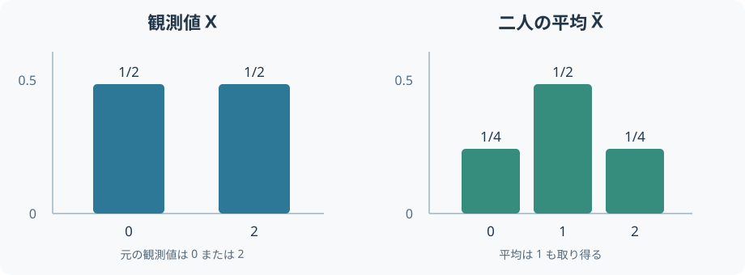

# 第8章　標本と標本分布

## 8.1 概要

標本は母集団から観測した一部であり、標本分布は標本から作る統計量を繰り返し計算したときの確率分布である。

## 8.2 使用場面

調査平均の推定誤差、世論調査の標本数の影響、標本抽出方式による精度の違いを考える。

## 8.3 基本的な考え方

母集団から標本を取り、同じ統計量を計算しても標本ごとに値が変わる。この変動の分布が標本分布であり、推定の標準誤差を決める。

ある町の全住民の平均通勤時間を知りたい。住民の一部から100人を調査し、その平均が35分だったとする。

35分という値は**調査した100人の平均**としては正確に計算できる。しかし、町の住民全体の平均がちょうど35分だとは分からない。別の100人を調べれば、たとえば33分や37分になるかもしれない。

この「同じ手続きを繰り返したとき、計算結果がどれくらい揺れるか」が推測統計の中心である。

ここで次の言葉を区別する。

| 用語 | 何を表すか | 例 |
|---|---|---|
| 母集団 | 知りたい対象全体 | 町の全住民 |
| 母数 | 母集団の未知の性質 | 真の平均通勤時間 $\mu$ |
| 標本 | 観測できた一部 | 調査した100人 |
| 統計量 | 標本から計算した値 | 標本平均 $\bar X$ |
| 推定値 | 実際の標本で計算した統計量の値 | 35分 |

**統計量は観測前には確率的に変わる。実際の標本が得られれば値が定まる。** この二つの見方を区別しよう。

## 8.4 数式とその意味

$
\operatorname{SE}(\bar X)=\frac{\sigma}{\sqrt n}
$

独立同分布で母分散が有限の場合、標本平均の標準誤差は母標準偏差 $\sigma$ を $\sqrt n$ で割る。

$\operatorname{SE}$ は *standard error*（標準誤差）、$\bar X$ は標本を取り直すと値が変わる確率変数としての標本平均、$\sigma$ は個々の観測値の母標準偏差、$n$ は標本数である。$\sqrt n$ は $n$ の平方根であり、個々の値のばらつきと平均の推定精度を区別する式である。

## 8.5 標本分布とは「統計量の分布」

観測値そのものの分布と、観測値から計算した平均の分布は同じではない。

例えば、ある母集団から一人選んだ値が0または2で、それぞれ確率1/2を持つとする。

一人の値を $X$ とすると、

$$
P(X=0)=\frac12,\qquad P(X=2)=\frac12
$$

である。

二人を独立に選び、平均 $\bar X=(X_1+X_2)/2$ を計算する。起こり得る組をすべて書き出そう。

| $X_1$ | $X_2$ | $\bar X$ | 組の確率 |
|---:|---:|---:|---:|
| 0 | 0 | 0 | 1/4 |
| 0 | 2 | 1 | 1/4 |
| 2 | 0 | 1 | 1/4 |
| 2 | 2 | 2 | 1/4 |

したがって標本平均の分布は、

$$
P(\bar X=0)=\frac14,\quad
P(\bar X=1)=\frac12,\quad
P(\bar X=2)=\frac14
$$

となる。

元の観測値は0か2だけだったのに、**標本平均は1にもなる**。さらに、平均1の確率が最も大きい。

*図8.1：同じ母集団から独立に2人を抽出したとき、個々の観測値の分布と平均の標本分布は異なる。棒の高さはそれぞれの値を取る確率を表す。*

このように、同じ標本抽出と計算を何度も繰り返したときの**統計量そのものの確率分布**を、標本分布と呼ぶ。

標本分布は、概念上の反復抽出から定まる分布であり、実際に何度も調査を行わないと存在しないわけではない。

## 8.6 標本平均の期待値はなぜ母平均になるか

$X_1,\ldots,X_n$ が同じ平均 $\mu$ を持つとする。標本平均は、

$$
\bar X=\frac{X_1+\cdots+X_n}{n}
$$

である。

期待値の線形性を使えば、

$$
\begin{aligned}
E[\bar X]
&=E\left[\frac1n\sum_{i=1}^n X_i\right]\\
&=\frac1n\sum_{i=1}^n E[X_i]\\
&=\frac1n(n\mu)=\mu
\end{aligned}
$$

となる。

これは、同じ抽出を多数回繰り返すと、標本平均の**平均**が母平均になることを表す。標本平均が母平均の**不偏推定量**であるという。

ここでの期待値の等式に、各観測の独立性は必要ない。ただし、各 $X_i$ が平均 $\mu$ を持つことは必要である。

**不偏であることは、個々の調査で必ず母平均に近いことを意味しない。** 大きく外れる調査結果もあり得る。

## 8.7 標本平均の分散はなぜ小さくなるか

標本の抽出が独立で、各観測値の分散が $\sigma^2$ だとしよう。

分散の公式から、

$$
\begin{aligned}
\operatorname{Var}(\bar X)
&=\operatorname{Var}\left(\frac1n\sum_{i=1}^nX_i\right)\\
&=\frac1{n^2}\sum_{i=1}^n\operatorname{Var}(X_i)\\
&=\frac1{n^2}(n\sigma^2)=\frac{\sigma^2}{n}
\end{aligned}
$$

となる。**独立性を使ったのは、分散を足し合わせた二行目である。**

標本平均の標準偏差、すなわち**標準誤差**（standard error; SE）は、

$$
\operatorname{SE}(\bar X)
=\sqrt{\operatorname{Var}(\bar X)}
=\frac{\sigma}{\sqrt n}
$$

である。

この式は重要なので、形の意味を確認しよう。

- 分子 $\sigma$：個々の観測値のばらつき。元のデータが散らばるほど平均も不安定。
- 分母 $\sqrt n$：観測数を増やす効果。平均は安定するが、改善は平方根の速さ。
- 全体：**個々の観測値**ではなく、**標本平均という統計量**のばらつき。

### 数値例：標本数を4倍にすると

母標準偏差が12分なら、

| 標本数 $n$ | 観測値の標準偏差 | 標本平均の標準誤差 |
|---:|---:|---:|
| 9 | 12分 | 4分 |
| 36 | 12分 | 2分 |
| 144 | 12分 | 1分 |

観測値の個人差は12分のままでも、平均の推定はだんだん安定する。

**標準誤差を半分にするには標本数を4倍にする必要がある**。データを増やすときの費用対効果を考える上でも重要である。

### 最初の例で確かめる

0と2を等確率で取る変数は、母平均1、母分散1である。$n=2$ の標本平均の分散は $1/2$ のはずだ。

実際に標本平均の分布から計算すると、

$$
\operatorname{Var}(\bar X)
=(0-1)^2\frac14+(1-1)^2\frac12+(2-1)^2\frac14
=\frac12
$$

となり、一般公式と一致する。

## 8.8 標準偏差と標準誤差を混同しない

どちらも「ばらつき」だが、答える問いが違う。

- **標準偏差（SD）**：個々の通勤時間はどれくらい違うか。
- **標準誤差（SE）**：今回の標本平均は、別の標本を取るとどれくらい変わるか。

母標準偏差 $\sigma$ が未知なら、標本標準偏差 $s$ を用いて、

$$
\widehat{\operatorname{SE}}(\bar X)=\frac{s}{\sqrt n}
$$

と推定することが多い。

ここで $s$ 自体も標本によって変わるので、推定された標準誤差も不確実な量になる。

**標準誤差が小さいことは、調査方法が偏っていないことの証明ではない。**

## 8.9 どう抽出したかで結果は変わる

ここまでの簡単な公式には、各観測値の独立性などの条件が必要だった。実際の調査では、標本の取り方を考慮しなければならない。

### 単純無作為抽出

母集団の各対象が公平に抽出される仕組みを設計する。有限母集団から復元せずに抽出する場合、標本数が母集団に比べて大きければ標準誤差が単純な独立抽出より小さくなる。

母集団サイズを $N$、復元なしでの単純無作為抽出サイズを $n$ とすると、母集団分散を $\sigma_N^2=N^{-1}\sum_{i=1}^N(x_i-\mu)^2$ と定義した場合、

$$
\operatorname{Var}(\bar X)
=\frac{\sigma_N^2}{n}\frac{N-n}{N-1}
$$

となる。最後の係数が**有限母集団補正**に相当する。

### クラスター抽出

学校を選んでから、その学校の生徒を調査するような方法では、同じ学校の生徒が似ている可能性がある。観測数が100人でも、互いに独立な100人と同じ情報量とは限らない。

### 層化抽出

年齢層などでグループに分け、各層から抽出すると、条件によっては精度が上がる。ただし、母集団の構成割合と標本の構成割合が違えば、適切な重み付けが必要になる。

### 選択バイアス

ネット上の任意回答アンケートで10万人から回答を集めても、特定の層だけが回答するなら母集団の平均を偏って推定してしまう。

**データの件数が増えても、抽出方法の系統的な偏りは自動的には消えない。**

## 8.10 統計量は平均以外にもある

標本平均だけが統計量ではない。

| 統計量 | 推定したい性質 | 主な特徴 |
|---|---|---|
| 標本平均 | 母平均 | 大きな値に敏感 |
| 標本中央値 | 母中央値 | 外れ値に比較的頑健 |
| 標本割合 | 母割合 | 0/1の平均に相当 |
| 標本分散 | 母分散 | 二乗偏差を使う |
| 標本分位点 | 母分位点 | 裾の分析に使える |

それぞれに標本分布があり、標準誤差や信頼区間を考えることができる。ただし、標本平均の $\sigma/\sqrt n$ を何にでもそのまま使えるわけではない。

## 8.11 演習

**問題1：標本分布の列挙**  
0または4を等確率で取る母集団から、独立に2回抽出する。標本平均の取り得る値と確率を書き、期待値と分散を求めよ。

**問題2：標準誤差**  
母標準偏差が15で、観測は独立同分布とする。$n=25$ と $n=100$ の標本平均の標準誤差を求めよ。

**問題3：標本数設計**  
母標準偏差を20と見積もるとき、標本平均の標準誤差を2以下にするには独立標本が最低何件必要か。

**問題4：判断**  
10,000人が自発的に回答したWebアンケートの平均は、100人の確率標本の平均より必ず信頼できるか。理由を述べよ。

**問題5：概念**  
独立でない観測値について、標本平均の分散を $\sigma^2/n$ と計算するとどんな問題が起こるか。

## 8.12 解答と解説

**問題1**：可能な組は $(0,0),(0,4),(4,0),(4,4)$ で、それぞれ確率1/4。標本平均の値は0（1/4）、2（1/2）、4（1/4）。平均は $0/4+2/2+4/4=2$、分散は $(0-2)^2/4+(4-2)^2/4=2$。元の分散4を $n=2$ で割った値と一致する。

**問題2**：$15/\sqrt{25}=3$、$15/\sqrt{100}=1.5$。標本数4倍で標準誤差が半分になる。

**問題3**：$20/\sqrt n\leq2$ から $\sqrt n\geq10$、よって $n\geq100$。

**問題4**：必ずしもそうではない。大規模な任意回答でも回答者の選択に偏りがあり得る。標本の代表性と標準誤差は別問題。

**問題5**：一般には共分散項が残るため、単純な式で分散を過小・過大評価する可能性がある。特に正のクラスター内相関が強ければ標準誤差を過小評価しやすい。

## 8.13 まとめ

標本平均という一つの数にも、標本抽出を繰り返したときの分布がある。それが標本分布である。独立同分布のもとでは、標本平均の期待値は母平均に等しく、標準誤差は $\sigma/\sqrt n$ となる。

次章では、標本数を増やしたときに標本平均がどう変わるかを、大数の法則と中心極限定理で説明する。
