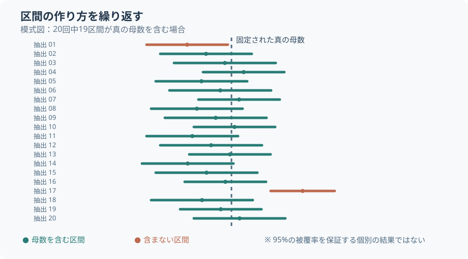

# 第12章　区間推定

## 12.1 概要

区間推定は、母数の不確実性を一つの値ではなく区間として表す方法である。頻度論の信頼区間は、同じ区間構成手順の長期的な被覆率で定義される。

## 12.2 使用場面

平均の推定結果に誤差の幅を添える、標本数が小さい推定の不確実性を伝える。

## 12.3 基本的な考え方

標本から得る区間は標本を取り直すたびに変化する。頻度論の信頼区間では、区間を作る手順の被覆率を評価する。

ある町の住民の平均通勤時間について、標本平均が35分だったとする。

標本数が10人なら、別の人を調査したときには大きく違う値になるかもしれない。一方、標本数が10,000人なら平均は比較的安定するだろう。

どちらも点推定値が35分でも、**推定の不確実性は同じではない**。

そこで母平均のありそうな範囲を、推定手順に対応する区間として示す。これが**区間推定**である。

## 12.4 数式とその意味

$
\bar X\pm z_{1-\alpha/2}\frac{\sigma}{\sqrt n}
$

母標準偏差 $\sigma$ が既知で適切な正規モデルなどの下では、この式が母平均の ## 12.4 数式とその意味

$$
\bar X\pm z_{1-\alpha/2}\frac{\sigma}{\sqrt n}
$$

母標準偏差 $\sigma$ が既知で適切な正規モデルなどの下では、この式が母平均の $1-\alpha$ 信頼区間になる。
-\alpha$ 信頼区間になる。

$\bar X$ は標本平均、$\pm$ は左右に同じ幅を足し引きする操作、$z_{1-\alpha/2}$ は標準正規分布の上側確率が $\alpha/2$ になる境界値である。$\alpha$ は信頼区間が母数を含まない長期的割合の目標（例：0.05）、$\sigma$ は母標準偏差、$n$ は標本数。この区間は標本によって変動する。

## 12.5 信頼区間は「繰り返すと何%含むか」

95%信頼区間について、まず重要な点を確認する。

**頻度論の95%信頼区間**は、同じ標本抽出と区間構成の手順を無数に繰り返したとき、作られた区間のおよそ95%が**固定された真の母数**を含むように設計されている。

この性質を**被覆率（coverage）**という。

実際に一つの標本を取り、たとえば $[31,39]$ 分という区間を得たあとでは、頻度論の枠組みでは母数 $\mu$ は確率変数ではなく固定値である。したがって、その観測済み区間について「母平均が95%の確率で入る」と直接解釈するのは正確ではない。

直感的には、**区間を作る方法が長期的に95%の割合で真値をつかむ**と考えよう。

*図12.1：95%の被覆率を説明する**模式図**。20本中19本という構成は例示のために選んだものであり、実際の20回の抽出で常に19本が母数を含むわけではない。確率が付いているのは区間を作る前の反復手順である。*

## 12.6 最も単純な例：正規分布、母分散が既知

$X_1,\ldots,X_n$ が独立に $N(\mu,\sigma^2)$ に従い、$\sigma$ が既知とする。

標本平均は正規分布

$$
\bar X\sim N\left(\mu,\frac{\sigma^2}{n}\right)
$$

に従う。

したがって、

$$
Z=\frac{\bar X-\mu}{\sigma/\sqrt n}\sim N(0,1)
$$

であり、標準正規分布では、

$$
P(-1.96\leq Z\leq1.96)\approx0.95
$$

となる。

この不等式を未知の $\mu$ について書き直すと、

$$
P\left(\bar X-1.96\frac{\sigma}{\sqrt n}
\leq\mu\leq
\bar X+1.96\frac{\sigma}{\sqrt n}\right)\approx0.95
$$

となる。

この式で確率的に変動するのは、標本を取る前の $\bar X$ と、それから作られる区間である。

実際のデータから標本平均 $\bar x$ を得たら、次の区間を報告する。

$$
\boxed{\bar x\pm1.96\frac{\sigma}{\sqrt n}}
$$

### 数値例：平均50、標準偏差12、標本数36

標本平均50、母標準偏差12、$n=36$ なら、標準誤差は、

$$
\frac{12}{\sqrt{36}}=2
$$

である。

95%信頼区間は、

$$
50\pm1.96\times2
=[46.08,\ 53.92]
$$

となる。

これは母平均についての区間であり、**個人の通勤時間の95%が46.08〜53.92分に入るという意味ではない**。

## 12.7 母分散が未知ならt分布を使う

現実のデータでは、母標準偏差 $\sigma$ は未知であることが多い。

そこで標本標準偏差 $s$ で置き換え、

$$
T=\frac{\bar X-\mu}{s/\sqrt n}
$$

を考える。

独立な正規分布の標本なら、この統計量は自由度 $n-1$ の**t分布**に従う。

95%信頼区間は、

$$
\boxed{
\bar x\pm t_{0.975,n-1}\frac{s}{\sqrt n}
}
$$

で与えられる。

$t_{0.975,n-1}$ は、自由度 $n-1$ のt分布の97.5%分位点である。

### なぜ正規分布ではなくt分布なのか

母標準偏差が分からず、$s$ で推定する分だけ追加の不確実性がある。t分布は正規分布より裾が厚く、小標本では臨界値が大きくなる。

例えば、自由度9のt分布なら95%両側区間の臨界値は約2.262で、正規分布の1.96より大きい。

### 数値例：標本数10

標本平均50、標本標準偏差10、$n=10$ なら、

$$
\frac{s}{\sqrt n}=\frac{10}{\sqrt{10}}\approx3.162
$$

である。

95%t信頼区間の半幅は、

$$
2.262\times3.162\approx7.15
$$

なので、

$$
[42.85,\ 57.15]
$$

となる。

同じ標準誤差に正規分布の1.96を使った区間より幅が広い。

## 12.8 信頼水準を上げれば区間は広くなる

信頼水準を90%、95%、99%と高くすると、真値を含む頻度を高くしたいので、通常は区間が広くなる。

母標準偏差既知の正規モデルの場合、

| 信頼水準 | 臨界値の近似 | 半幅 |
|---|---:|---|
| 90% | 1.645 | $1.645\sigma/\sqrt n$ |
| 95% | 1.960 | $1.960\sigma/\sqrt n$ |
| 99% | 2.576 | $2.576\sigma/\sqrt n$ |

**狭い区間で高い被覆率を実現したいなら、通常は標本数を増やす必要がある。**

## 12.9 区間の幅から必要標本数を考える

母標準偏差を $\sigma$ と見積もり、95%信頼区間の半幅を $m$ 以下にしたいとする。

$$
1.96\frac{\sigma}{\sqrt n}\leq m
$$

を変形すると、

$$
n\geq\left(\frac{1.96\sigma}{m}\right)^2
$$

となる。

例えば $\sigma=10$、半幅2以下なら、

$$
n\geq\left(\frac{1.96\times10}{2}\right)^2
=96.04
$$

だから、切り上げて**少なくとも97件**必要である。

ただしこの計算は、独立標本・モデル仮定・既知または妥当に見積もった母標準偏差などを前提とする。回答率や抽出設計も実際の調査では考慮する。

## 12.10 母割合の区間は注意が必要

独立なベルヌーイ試行で、標本成功割合を $\hat p$ とすると、

$$
\widehat{\operatorname{SE}}(\hat p)
=\sqrt{\frac{\hat p(1-\hat p)}{n}}
$$

と近似できる。

単純な正規近似の区間は、

$$
\hat p\pm1.96\sqrt{\frac{\hat p(1-\hat p)}n}
$$

である。

しかし標本数が少ないときや $\hat p$ が0や1に近いとき、この区間は被覆率が悪かったり、0未満や1超の端点を出したりする。

**割合の区間推定には、Wilson区間などの方法を検討する**。本書では、単純なWald区間を万能な既定値として扱わない。

## 12.11 信頼区間・予測区間・信用区間の違い

名称が似ていても、対象が違う。

| 区間 | 対象 | 解釈の基本 |
|---|---|---|
| 信頼区間（confidence interval） | 母平均や回帰係数など | 繰り返した区間構成の被覆率 |
| 予測区間（prediction interval） | 次の個別観測など | 将来の観測が入る範囲 |
| 信用区間（credible interval） | ベイズの母数の事後分布 | モデルと事前分布のもとでの事後確率 |

### 予測区間のほうが通常広い

母平均の推定誤差が小さくても、個々の値のばらつきは残る。

独立な正規モデルで、新しい個別観測を予測するときは、平均の推定誤差に加えて、個々の観測値自身のランダムな変動を含める必要がある。

そのため通常、**新しい個人の値の予測区間は、母平均の信頼区間より広い**。

## 12.12 区間を報告するときの落とし穴

### バイアスは狭い区間でも消えない

標本が特定の属性の人に偏っているなら、標本数を増やして標準誤差を小さくしても、系統的な偏りは残り得る。

狭い信頼区間が常に正しいとは限らない。

### 事後的に条件を選ぶと被覆率が崩れることがある

たくさんの候補を試して「都合のよい結果だけ」を選んで報告すると、通常の95%被覆率はそのまま保証されない。

### 区間が重なるかだけで検定しない

二つの95%信頼区間が重なっているからといって、二群の平均差が有意でないと断言できない。群間差を検定したいなら、**差そのものの標準誤差と信頼区間**を計算すべきである。

## 12.13 演習

**問題1：正規モデルの信頼区間**  
標本平均10、既知の母標準偏差8、標本数64のとき、95%信頼区間を求めよ。

**問題2：t区間**  
標本平均20、標本標準偏差4、$n=16$。自由度15の95%t臨界値を約2.131として区間を求めよ。

**問題3：必要標本数**  
母標準偏差を5と見積もる。95%信頼区間の半幅を1以下にするため、必要な最小標本数を求めよ。

**問題4：概念**  
「得られた95%信頼区間に真の母平均が95%の確率で入っている」という表現について、頻度論的に正確な言い方に直せ。

**問題5：使い分け**  
翌日の一人の通勤時間を予測したい。母平均の信頼区間と個別観測の予測区間のどちらが適切か。その理由を述べよ。

## 12.14 解答・解説

**問題1**：標準誤差は $8/\sqrt{64}=1$。$10\pm1.96$ より $[8.04,11.96]$。

**問題2**：標準誤差は $4/\sqrt{16}=1$。$20\pm2.131$ より $[17.869,22.131]$。

**問題3**：$n\geq(1.96\times5)^2=96.04$。切り上げて97件。

**問題4**：同じ抽出方法と区間の作り方を何度も繰り返すと、得られる区間のおよそ95%が固定された真の母平均を含む、という意味。

**問題5**：個別観測の予測区間が適切。母平均の推定誤差に加え、個人ごとのばらつきも考慮する必要がある。

## 12.15 まとめ

- 信頼区間は**区間構成の長期的な被覆率**に基づく。
- 正規モデルで母標準偏差が既知ならz区間、未知で正規標本ならt区間を使う。
- 標本数が増えると区間は狭くなりやすいが、系統的な偏りは自動でなくならない。
- 母平均の信頼区間と個別観測の予測区間は別物。
- 母割合や複雑な統計量には、それぞれ適切な区間推定法を選ぶ。

次章では、特定の仮説とデータがどの程度整合するかを調べる**仮説検定**を扱う。
