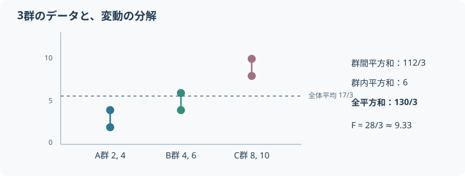

# 第24章　分散分析

> **この章の目標**：3群以上の平均を比較する考え方を理解する。全変動を群間・群内へ分解し、F統計量を元データから求め、仮定と多重比較の必要性を説明できる。

## 24.1 平均が三つあるとき、どのように比較するか

三種類の教材A・B・Cを使った生徒の平均点を比較したい。

各教材の平均点に違いがあっても、少数の生徒だけの結果なら偶然の違いかもしれない。平均値の差だけでなく、**同じ教材を使った生徒どうしのばらつき**も考える必要がある。

二群だけなら平均差のt検定が使えるが、三群以上で全組合せのt検定を無調整で繰り返すと、少なくとも一つの偶然の有意差を見つける確率が高まる。

**分散分析（analysis of variance; ANOVA）**は、群ごとの平均がすべて等しいという仮説を、全変動の分解から一度に評価する方法である。

## 24.2 一元配置ANOVAのモデル

群を $j=1,\ldots,k$、群内の観測を $i=1,\ldots,n_j$ とする。

$$
Y_{ij}=\mu_j+\varepsilon_{ij}
$$

と考える。$\mu_j$ は群 $j$ の母平均、$\varepsilon_{ij}$ は各観測の誤差である。

検定したい帰無仮説は、

$$
H_0:\mu_1=\mu_2=\cdots=\mu_k
$$

である。

対立仮説は「少なくとも一つの群平均が異なる」というもの。**すべての組合せで平均が異なる**という意味ではない。

## 24.3 全変動を二つへ分解する

全観測の平均を $\bar Y$、群 $j$ の平均を $\bar Y_j$ とする。

各観測値の平均からのずれは、

$$
Y_{ij}-\bar Y
=(Y_{ij}-\bar Y_j)+(\bar Y_j-\bar Y)
$$

と書ける。

右辺第一項は**群の中でのずれ**、第二項は**群平均そのもののずれ**である。

両辺を二乗して全件で足し合わせると、交差項は群内の偏差の和が0になるため消え、

$$
\underbrace{\sum_j\sum_i(Y_{ij}-\bar Y)^2}_{SS_T}
=
\underbrace{\sum_j n_j(\bar Y_j-\bar Y)^2}_{SS_B}
+
\underbrace{\sum_j\sum_i(Y_{ij}-\bar Y_j)^2}_{SS_W}
$$

となる。

ここで、

- $SS_T$：全平方和（total sum of squares）
- $SS_B$：群間平方和（between-group sum of squares）
- $SS_W$：群内平方和（within-group sum of squares）

である。記号は資料によって $SST,SSB,SSW$ などとも書く。

**全体のばらつき＝群平均の違い＋群内のばらつき**という分解がANOVAの出発点である。

## 24.4 六つの値を使って手計算する

次のデータを考える。

| 群 | 観測値 | 群平均 |
|---|---|---:|
| A | 2, 4 | 3 |
| B | 4, 6 | 5 |
| C | 8, 10 | 9 |

全観測数は6、合計は34なので、全体平均は、

$$
\bar Y=\frac{34}{6}=\frac{17}{3}\approx5.667
$$

である。

### 群内平方和

各群で平均との差の二乗を足すと、

$$
SS_W=(2-3)^2+(4-3)^2
+(4-5)^2+(6-5)^2
+(8-9)^2+(10-9)^2
=6
$$

となる。

### 群間平方和

各群に2人ずついるので、

$$
SS_B=2(3-17/3)^2+2(5-17/3)^2+2(9-17/3)^2
=\frac{112}{3}
$$

となる。

全平方和は、

$$
SS_T=SS_B+SS_W
=\frac{112}{3}+6
=\frac{130}{3}
$$

である。各観測から全体平均を引いて直接二乗和を計算しても同じ値になる。

*図24.1：群ごとの平均との差と各群の内部のばらつきを分けて考える。平方和は群間 $112/3$、群内6、合計 $130/3$。*

## 24.5 平方和を自由度で割る

群間平方和と群内平方和は、観測数や群数が大きいほど増える傾向がある。そこで、それぞれを自由度で割った**平均平方（mean square）**に直す。

群数を $k$、全観測数を $N=\sum_jn_j$ とすると、

$$
MS_B=\frac{SS_B}{k-1}
$$

$$
MS_W=\frac{SS_W}{N-k}
$$

である。

群間の自由度は $k-1$、群内の自由度は $N-k$。全体の自由度 $N-1$ と整合し、

$$
(N-1)=(k-1)+(N-k)
$$

となる。

今回の例では $k=3,N=6$ だから、

$$
MS_B=\frac{112/3}{2}=\frac{56}{3}
$$

$$
MS_W=\frac6{3}=2
$$

である。

## 24.6 F統計量を求める

F統計量は群間平均平方と群内平均平方の比である。

$$
F=\frac{MS_B}{MS_W}
$$

今回のデータなら、

$$
F=\frac{(112/3)/2}{6/3}=\frac{28}{3}\approx9.33
$$

となる。

帰無仮説の下で、独立な正規誤差と共通の分散などの条件が成り立つなら、

$$
F\sim F_{k-1,N-k}
$$

というF分布を使って検定できる。

今回の自由度は $(2,3)$。F値が大きいほど、群内のばらつきに比べて群間の平均差が大きく、**すべての母平均が等しいという仮説と整合しにくい**と判断する。

ただし、「F値が9.33」だけで判断せず、**自由度に対応したF分布のp値や臨界値**と比較する。

## 24.7 なぜF比を使えるのか

帰無仮説の下で群平均がすべて同じなら、群ごとの平均差も主に偶然の誤差から生じる。

したがって、$MS_B$ と $MS_W$ はどちらも、一定の条件のもとで同じ誤差分散 $\sigma^2$ の推定に関係する。

平均が本当に異なるなら、$MS_B$ は平均差の影響で大きくなるが、群内の誤差分散を表す $MS_W$ は同じようには増えない。

この**比の偏り**を検定の根拠にする。

F統計量が十分大きい場合、少なくとも一つの平均が異なるという証拠を得られる。ただし、**どの群が違うか**は分からない。

## 24.8 多重比較はなぜ必要か

ANOVAの全体検定で帰無仮説を棄却できても、A対B、A対C、B対Cのうちどれが異なるかは別問題である。

例えば3群なら比較は3通りある。群数が増えると比較数は、

$$
\frac{k(k-1)}{2}
$$

通りに増える。

無調整の検定を繰り返すと誤発見の可能性が増えるため、**Tukeyの多重比較法**など、比較する対象と管理したい誤り率に応じた方法を用いる。

また、実験前から特定の比較だけを主要な問いとして決めている場合と、結果を見てからすべての組合せを探索する場合では、必要な推測の設計が違う。

## 24.9 仮定が合わないとき

### 独立性

同じ生徒を3回測ったデータを「別々の3群の独立標本」として扱ってはならない。対応があるデータには繰り返し測定ANOVAや混合効果モデルなどを検討する。

### 分散の等しさ

群によって分散が大きく異なる場合、通常のF検定の性質が崩れることがある。**WelchのANOVA**などの方法が候補になる。

### 正規性・小標本

標準的な一元配置ANOVAの小標本でのF分布を厳密に用いるには正規誤差が重要。極端な外れ値、強い歪み、少数の観測には注意する。

### 因果解釈

群の平均が異なることは、教材や介入がその差を引き起こした証明ではない。無作為割付や交絡の扱いを別途考える。

## 24.10 t検定との関係

群が2つだけなら、等分散を仮定した二標本t検定の統計量 $t$ と、一元配置ANOVAのF統計量には、

$$
F=t^2
$$

という関係がある（両者のモデル・自由度が対応している場合）。

つまりANOVAは、平均の比較という共通の考え方を、3群以上にも広げるものと理解できる。

## 24.11 演習

**問題1**：A=(1,3)、B=(5,7)の全体平均、群内平方和、群間平方和、全平方和を求めよ。

**問題2**：群間平方和30（自由度2）、群内平方和60（自由度12）のF値を求めよ。

**問題3**：$k=5,N=60$ の一元配置ANOVAで群間・群内の自由度を求めよ。

**問題4**：ANOVAで全体の帰無仮説を棄却したあと、どの群が違うかを調べるには何が必要か。

**問題5**：同じ参加者を3つの時点で測定した結果に、独立標本の一元配置ANOVAを単純に適用しにくい理由を述べよ。

**問題6**：群間変動が増え、群内変動が一定ならF値は一般にどう変わるか。

## 24.12 演習の解答と解説

**問題1**：全体平均4。群平均は2と6。群内平方和は各群2ずつで4、群間平方和は $2(2-4)^2+2(6-4)^2=16$。全平方和は20。

**問題2**：$F=(30/2)/(60/12)=15/5=3$。

**問題3**：群間自由度は4、群内自由度は55。

**問題4**：目的に合った事後比較や事前に定めた比較を行い、多重比較による誤り率も考慮する。

**問題5**：同じ人の観測値どうしが関連し、独立性の仮定が適切でないことがあるから。

**問題6**：群間平均平方が大きくなり、分母の群内平均平方が一定ならF値は大きくなる。

## 再現してみよう

A=(2,4)、B=(4,6)、C=(8,10)から、群間・群内平方和とF値を独立に再計算します。

[再現可能な計算例と実行方法](../reproduce.html)

## 24.13 まとめ

- ANOVAは全変動を群間平方和と群内平方和に分解する。
- 平方和を自由度で割り、その比 $F=MS_B/MS_W$ を使う。
- 有意でもどの群の平均が異なるかは別途調べる。
- 独立性・等分散性・正規性・多重比較・因果解釈に注意する。

次章では、群間の差を因果的に比較するための実験計画を考える。
